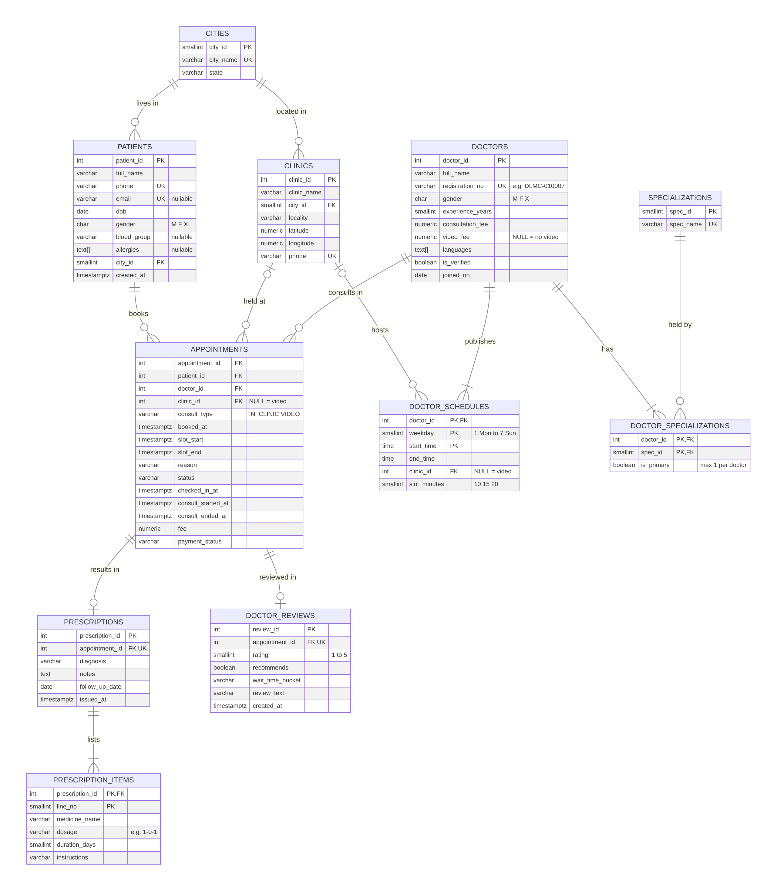
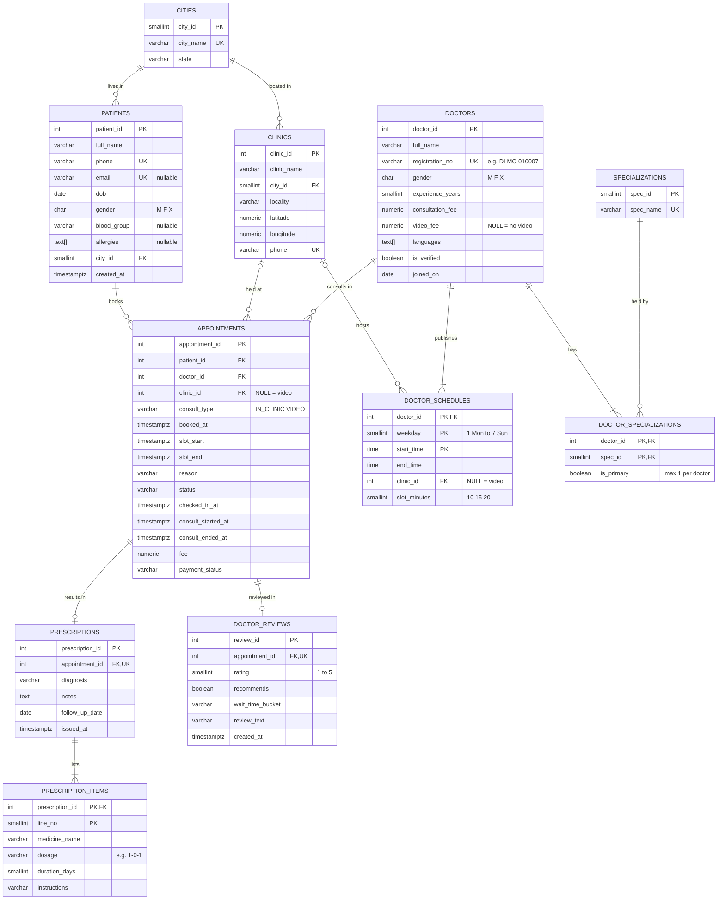

# 02 · Schema design (Phase 2)

Files: [`sql/01_schema.sql`](../sql/01_schema.sql) · [`sql/02_load_data.sql`](../sql/02_load_data.sql) · [`diagrams/er_diagram.png`](../diagrams/er_diagram.png) (source: [`diagrams/er_diagram.mmd`](../diagrams/er_diagram.mmd))

```bash
createdb practo
psql -d practo -f sql/01_schema.sql      # schema "practo", 11 tables, constraints only
unzip seed_data.zip                      # -> seed_data/ (git-ignored)
psql -d practo -f sql/02_load_data.sql   # run from the repo root: loads 11 CSVs, ANALYZE, row counts, integrity checks
```

**Result:** the schema runs top to bottom on an empty database, and **all 11 files load with no errors and no rejected rows** (counts in §8). All 30 workload queries run against it unchanged (`psql -d practo -f queries/workload_30.sql`, which ends in `ROLLBACK`).

---

## 1. Design decisions at a glance

| Decision | Why |
|---|---|
| Everything in schema **`practo`** | Required by the brief; the workload does `SET search_path TO practo`. |
| **Database time zone = `Asia/Kolkata`** (set by `01_schema.sql` with `ALTER DATABASE … SET timezone`) | All timestamps are IST (`+05:30`). R03 builds slots with `('2026-07-03'::date + start_time)::timestamptz`, which uses the *session* time zone. `run_benchmark.sh` opens fresh sessions without setting one. We tested this: with a UTC session, R03 offers doctor 217's first slot at **15:30 IST** instead of **10:00 IST**, so every slot is wrong. Date casts (R05, R17, R20) also follow the session time zone. |
| IDs: `integer`; tiny lookups (`city_id`, `spec_id`): `smallint` | `integer` holds 2.1 billion, enough even for 100× growth (≈15 M appointments). Two bytes cover 10 cities / 15 specializations. |
| Money: `numeric(8,2)` | Exact decimals. `float` gives rounding errors in sums (R16), and `money` depends on the server locale. |
| Instants: `timestamptz`; clock times: `time`; days: `date` | Data carries an offset, so `timestamptz` stores the true instant. Schedule hours have no date; `dob`, `joined_on`, `follow_up_date` have no time. |
| Yes/no: `boolean` | The CSV uses `t`/`f`, which Postgres reads as boolean. |
| Codes (status, consult type, …): `varchar(n)` + `CHECK (… IN (…))` | Visible and easy to change. An `ENUM` value can't be removed once added, and the queries compare against plain string literals. |
| `languages`, `allergies`: `text[]` | The CSV holds Postgres array literals (`{English,Hindi}`), and the queries use array operators (`= ANY`, `@>`). See §7 for the 1NF trade-off. |
| Phase 2 creates **constraints only** | Only the indexes Postgres builds for PK / UNIQUE / EXCLUDE exist (§6), so the Phase 3 baseline reflects an untuned database. |

---

## 2. ER diagram and relationships



| Relationship | Cardinality | Implemented by |
|---|---|---|
| city – clinics | 1 : N | `clinics.city_id` FK |
| city – patients | 1 : N | `patients.city_id` FK |
| doctors – specializations | **M : N** | link table `doctor_specializations` (PK `doctor_id, spec_id`); every doctor has 1–2 (3,000 doctors, 3,700 rows), exactly one primary |
| doctor – weekly schedule blocks | 1 : N (each doctor has ≥ 1) | `doctor_schedules.doctor_id` FK |
| clinic – schedule blocks | 0..1 : N (`NULL` = video block) | `doctor_schedules.clinic_id` nullable FK; 292 clinics have no block at all |
| patient – appointments | 1 : N | `appointments.patient_id` FK |
| doctor – appointments | 1 : N | `appointments.doctor_id` FK |
| clinic – appointments | 0..1 : N (`NULL` = video) | `appointments.clinic_id` nullable FK |
| appointment – prescription | **1 : 0..1** | `prescriptions.appointment_id` FK + **UNIQUE** (97,234 of 121,409 completed appointments have one) |
| prescription – items | 1 : N (each has 1–4 lines) | `prescription_items.prescription_id` FK, PK `(prescription_id, line_no)` |
| appointment – review | **1 : 0..1** | `doctor_reviews.appointment_id` FK + **UNIQUE** |

Mermaid source (renders on GitHub):



---

## 3. Data dictionary

Abbreviations: **PK** primary key · **FK** foreign key · **UQ** unique · **NN** NOT NULL. Every CHECK is named in `01_schema.sql`.

### cities (10 rows)
| Column | Type | Constraint | Why |
|---|---|---|---|
| city_id | smallint | PK | 10 rows; 2 bytes is enough |
| city_name | varchar(50) | NN, UQ | Natural key; two cities never share a name |
| state | varchar(50) | NN | **Not** unique: Mumbai and Pune are both in Maharashtra |

### specializations (15 rows)
| Column | Type | Constraint | Why |
|---|---|---|---|
| spec_id | smallint | PK | 15 rows |
| spec_name | varchar(50) | NN, UQ | R01 looks a specialization up **by name**; a duplicate name would make it ambiguous |

### doctors (3,000 rows)
| Column | Type | Constraint | Why |
|---|---|---|---|
| doctor_id | integer | PK | |
| full_name | varchar(100) | NN | Not unique: only 100 distinct names across 3,000 doctors |
| registration_no | varchar(20) | NN, UQ, CHECK `^[A-Z]{2,4}MC-[0-9]{6}$` | One medical council registration per doctor (e.g. `DLMC-010007`); R23 looks it up |
| gender | char(1) | NN, CHECK `M/F/X` | Same domain as patients (data has M, F) |
| experience_years | smallint | NN, CHECK 0–70 | Small whole number (data 1–38) |
| consultation_fee | numeric(8,2) | NN, CHECK > 0 | Money |
| video_fee | numeric(8,2) | CHECK > 0 or NULL | **NULL = doctor does not offer video** (894 doctors; none of them has a video schedule, IC4) |
| languages | text[] | NN, CHECK ≥ 1 element, no NULL element | Array literal in the CSV; R18 uses `'Tamil' = ANY(languages)` |
| is_verified | boolean | NN, default false | |
| joined_on | date | NN | Date only |

### doctor_specializations (3,700 rows)
| Column | Type | Constraint | Why |
|---|---|---|---|
| doctor_id | integer | PK part, FK → doctors **CASCADE** | |
| spec_id | smallint | PK part, FK → specializations **RESTRICT** | |
| is_primary | boolean | NN, default false | |
| *(table)* | | **PK (doctor_id, spec_id)** | A doctor holds a specialization once. `doctor_id` alone is not unique (700 doctors have 2 rows) |
| *(table)* | | **EXCLUDE (doctor_id WITH =) WHERE is_primary** | *"What stops a doctor having two primary specializations?"* This constraint does: at most one `is_primary = true` row per doctor. It is a partial unique index written as a constraint. "At least one primary" can't be a CHECK, so it is verified by IC5. |

### clinics (1,500 rows)
| Column | Type | Constraint | Why |
|---|---|---|---|
| clinic_id | integer | PK | |
| clinic_name | varchar(100) | NN | Unique in the data, but two branches could share a name, so we don't declare UQ |
| city_id | smallint | NN, FK → cities **RESTRICT** | |
| locality | varchar(50) | NN | |
| latitude | numeric(8,6) | NN, CHECK in India (6–38) | Exact 6-decimal value as exported |
| longitude | numeric(9,6) | NN, CHECK in India (68–98) | |
| phone | varchar(20) | NN, UQ, CHECK `^\+91-[0-9]{2}-[0-9]{7}$` | Each clinic has its own landline |

### doctor_schedules (30,499 rows)
| Column | Type | Constraint | Why |
|---|---|---|---|
| doctor_id | integer | PK part, FK → doctors **CASCADE** | The timetable belongs to the doctor |
| weekday | smallint | PK part, NN, CHECK 1–7 | ISO: 1 = Mon … 7 = Sun. Data has 1–6, and R03 uses 5 = Friday. All 150,000 appointments match their schedule using ISO weekday (IC1) |
| start_time | time | PK part, NN | |
| end_time | time | NN, CHECK `end_time > start_time` | |
| clinic_id | integer | FK → clinics **CASCADE**, nullable | **NULL = video block** (all 5,899 NULLs are the 21:00–22:00 video block) |
| slot_minutes | smallint | NN, CHECK IN (10, 15, 20), CHECK block splits into whole slots | |
| *(table)* | | **PK (doctor_id, weekday, start_time)** | A doctor can't start two blocks at the same moment. `(doctor_id, weekday)` alone is not unique: e.g. Monday 10–13 at a clinic plus Monday 21–22 on video |

### patients (40,000 rows)
| Column | Type | Constraint | Why |
|---|---|---|---|
| patient_id | integer | PK | |
| full_name | varchar(100) | NN | Not unique (500 distinct names) |
| phone | varchar(10) | NN, UQ, CHECK `^[6-9][0-9]{9}$` | Sign-in by mobile (R06). Text, not a number: we never do arithmetic on it, and R06 compares it to a string |
| email | varchar(254) | UQ, CHECK format, nullable | Optional. UNIQUE still allows many NULLs |
| dob | date | NN, CHECK ≥ 1900-01-01 | |
| gender | char(1) | NN, CHECK `M/F/X` | Data has all three |
| blood_group | varchar(3) | CHECK IN (A±, B±, AB±, O±), nullable | NULL = not known |
| allergies | text[] | CHECK non-empty and no NULL element, nullable | NULL = no known allergy. An empty array is rejected so "none" has exactly one representation. R10 uses `@> ARRAY['Penicillin']` |
| city_id | smallint | NN, FK → cities **RESTRICT** | |
| created_at | timestamptz | NN | |

### appointments (150,000 rows)
| Column | Type | Constraint | Why |
|---|---|---|---|
| appointment_id | integer | PK | W01 inserts id 90,000,001, which still fits in `integer` |
| patient_id | integer | NN, FK → patients **RESTRICT** | |
| doctor_id | integer | NN, FK → doctors **RESTRICT** | |
| clinic_id | integer | FK → clinics **RESTRICT**, nullable | NULL ⇔ VIDEO (CHECK `chk_appt_clinic_iff_in_clinic`) |
| consult_type | varchar(10) | NN, CHECK IN (IN_CLINIC, VIDEO) | |
| booked_at | timestamptz | NN, CHECK `booked_at <= slot_start` | You can't book a slot that has already started |
| slot_start | timestamptz | NN | |
| slot_end | timestamptz | NN, CHECK `> slot_start`, CHECK length is 10/15/20 min | |
| reason | varchar(100) | NN | Always filled |
| status | varchar(12) | NN, default BOOKED, CHECK IN (BOOKED, **CHECKED_IN**, COMPLETED, CANCELLED, NO_SHOW) | `CHECKED_IN` never appears in the export, but **W02 writes it and W04 reads it**, so it must be allowed |
| checked_in_at | timestamptz | nullable, CHECK only for IN_CLINIC | Only patients who come to a clinic check in |
| consult_started_at | timestamptz | nullable | |
| consult_ended_at | timestamptz | nullable, CHECK ≥ start (and start present), CHECK `COMPLETED ⇔ ended_at IS NOT NULL` | |
| fee | numeric(8,2) | NN, CHECK ≥ 0 | Price charged at booking (see §7) |
| payment_status | varchar(10) | NN, default PENDING, CHECK IN (PENDING, PAID, REFUNDED), CHECK REFUNDED ⇒ CANCELLED | Money is only refunded for a cancellation |

### prescriptions (97,234 rows)
| Column | Type | Constraint | Why |
|---|---|---|---|
| prescription_id | integer | PK | |
| appointment_id | integer | NN, **UQ**, FK → appointments **RESTRICT** | One prescription per appointment (1:1) |
| diagnosis | varchar(100) | NN | |
| notes | text | nullable | Optional free text |
| follow_up_date | date | nullable, CHECK after the issue day (IST) | NULL = no follow-up. When set it is 7–36 days later |
| issued_at | timestamptz | NN | |

### prescription_items (243,085 rows)
| Column | Type | Constraint | Why |
|---|---|---|---|
| prescription_id | integer | PK part, FK → prescriptions **CASCADE** | |
| line_no | smallint | PK part, CHECK ≥ 1 | Restarts at 1 on every prescription (1–4, no gaps), so `line_no` alone is not a key |
| medicine_name | varchar(100) | NN | |
| dosage | varchar(5) | NN, CHECK `^[0-9]-[0-9]-[0-9]$` and not `0-0-0` | Morning–afternoon–night, e.g. `1-0-1` |
| duration_days | smallint | NN, CHECK 1–365 | |
| instructions | varchar(100) | nullable | Optional (After food / Before food / At bedtime) |

### doctor_reviews (30,339 rows)
| Column | Type | Constraint | Why |
|---|---|---|---|
| review_id | integer | PK | |
| appointment_id | integer | NN, **UQ**, FK → appointments **CASCADE** | One review per consultation (1:1) |
| rating | smallint | NN, CHECK 1–5 | |
| recommends | boolean | NN | |
| wait_time_bucket | varchar(10) | NN, CHECK IN (`<15 min`, `15-30 min`, `30-60 min`, `>1 hr`) | Derived (see §7) |
| review_text | varchar(500) | nullable | 12,069 reviews are a rating only |
| created_at | timestamptz | NN | |

---

## 4. Keys and foreign keys (ON DELETE rules)

**Composite primary keys:** `doctor_specializations (doctor_id, spec_id)`, `doctor_schedules (doctor_id, weekday, start_time)`, `prescription_items (prescription_id, line_no)`. All other tables use their single `*_id` column.

| # | Foreign key | ON DELETE | Why |
|---|---|---|---|
| 1 | clinics.city_id → cities | RESTRICT | A city with clinics must not disappear |
| 2 | patients.city_id → cities | RESTRICT | Same |
| 3 | doctor_specializations.doctor_id → doctors | CASCADE | Pure link rows; meaningless without the doctor |
| 4 | doctor_specializations.spec_id → specializations | RESTRICT | Don't delete a specialization that doctors still hold |
| 5 | doctor_schedules.doctor_id → doctors | CASCADE | The timetable is part of the doctor's profile |
| 6 | doctor_schedules.clinic_id → clinics | CASCADE | Blocks at a closed clinic go away. **Not SET NULL**: NULL means "video", so SET NULL would silently turn clinic hours into video hours |
| 7 | appointments.patient_id → patients | RESTRICT | Medical and payment history must be kept (anonymise instead of deleting) |
| 8 | appointments.doctor_id → doctors | RESTRICT | Same; a doctor with history is deactivated, not deleted |
| 9 | appointments.clinic_id → clinics | RESTRICT | Finance reports per clinic (R16). SET NULL would also break `chk_appt_clinic_iff_in_clinic` |
| 10 | prescriptions.appointment_id → appointments | RESTRICT | A prescription is a medical record and must not vanish as a side effect |
| 11 | prescription_items.prescription_id → prescriptions | CASCADE | Line items are part of the prescription |
| 12 | doctor_reviews.appointment_id → appointments | CASCADE | A review has no meaning without its appointment, and there's no legal reason to keep it |

Combined effect: a doctor or patient who has appointments can't be deleted (RESTRICT wins over the CASCADEs), which is what a medical system wants.

---

## 5. NULL vs NOT NULL: when and why columns are empty

62 of the 75 columns are NOT NULL. The 13 nullable columns are empty for a business reason we checked in the data:

| Column | Empty rows | When / why |
|---|---:|---|
| doctors.video_fee | 894 | Doctor doesn't offer video. None of these 894 has a video schedule or a video appointment (IC4). For the other 2,106 doctors, video fee = consultation fee − 100 |
| doctor_schedules.clinic_id | 5,899 | Video block. Every NULL is the 21:00–22:00 block, 15-min slots |
| appointments.clinic_id | 27,856 | Exactly the VIDEO appointments (27,856 = number of VIDEO rows) |
| appointments.checked_in_at | 51,180 | Filled only for **completed in-clinic** visits (98,820). Empty for video (patient never comes in), BOOKED (future), CANCELLED and NO_SHOW |
| appointments.consult_started_at / consult_ended_at | 28,591 each | The consultation never happened: BOOKED 1,823 + CANCELLED 14,900 + NO_SHOW 11,868 = 28,591. Filled for all 121,409 COMPLETED |
| prescriptions.follow_up_date | 68,184 | Doctor did not ask for a follow-up |
| prescriptions.notes | 58,105 | Optional note |
| patients.allergies | 33,986 (85%) | No known allergy |
| patients.blood_group | 3,204 (8%) | Blood group not known |
| patients.email | 13,940 (35%) | Optional; the mobile number is the login |
| prescription_items.instructions | 97,233 | Optional |
| doctor_reviews.review_text | 12,069 | Star rating without text |

Status combinations seen in the data (this is what the CHECKs encode):

| status | consult_type | payment_status | rows | clinic | check-in | consult times |
|---|---|---|---:|:-:|:-:|:-:|
| BOOKED | IN_CLINIC / VIDEO | PENDING | 1,459 / 364 | ✔ / – | – | – |
| CANCELLED | IN_CLINIC / VIDEO | PAID or REFUNDED | 12,182 / 2,718 | ✔ / – | – | – |
| COMPLETED | IN_CLINIC | PAID / PENDING | 74,137 / 24,683 | ✔ | ✔ | ✔ |
| COMPLETED | VIDEO | PAID | 22,589 | – | – | ✔ |
| NO_SHOW | IN_CLINIC / VIDEO | PAID, PENDING / PAID | 9,683 / 2,185 | ✔ / – | – | – |

---

## 6. Constraints and indexes that exist

| Constraint type | Count |
|---|---:|
| PRIMARY KEY | 11 |
| FOREIGN KEY | 12 |
| UNIQUE | 8 (`city_name`, `spec_name`, `registration_no`, `clinics.phone`, `patients.phone`, `patients.email`, `prescriptions.appointment_id`, `doctor_reviews.appointment_id`) |
| EXCLUDE | 1 (one primary specialization per doctor) |
| **CHECK** | **36** |
| NOT NULL columns | 62 |

**The 36 CHECK constraints**

| # | Name | Rule |
|---|---|---|
| 1 | chk_doctors_registration_format | `^[A-Z]{2,4}MC-[0-9]{6}$` |
| 2 | chk_doctors_gender | M / F / X |
| 3 | chk_doctors_experience | 0–70 years |
| 4 | chk_doctors_consultation_fee | > 0 |
| 5 | chk_doctors_video_fee | NULL or > 0 |
| 6 | chk_doctors_languages | at least one language, no NULL element |
| 7 | chk_clinics_in_india | lat 6–38, long 68–98 |
| 8 | chk_clinics_phone_format | `+91-NN-NNNNNNN` |
| 9 | chk_schedules_weekday | 1–7 |
| 10 | chk_schedules_time_order | end_time > start_time |
| 11 | chk_schedules_slot_minutes | 10, 15 or 20 |
| 12 | chk_schedules_whole_slots | block length divisible by slot_minutes |
| 13 | chk_patients_phone_format | 10-digit Indian mobile starting 6–9 |
| 14 | chk_patients_email_format | `x@y.tld` |
| 15 | chk_patients_gender | M / F / X |
| 16 | chk_patients_blood_group | 8 ABO/Rh groups |
| 17 | chk_patients_dob | ≥ 1900-01-01 |
| 18 | chk_patients_allergies | NULL or non-empty array with no NULL element |
| 19 | chk_appt_consult_type | IN_CLINIC / VIDEO |
| 20 | chk_appt_status | BOOKED / CHECKED_IN / COMPLETED / CANCELLED / NO_SHOW |
| 21 | chk_appt_payment_status | PENDING / PAID / REFUNDED |
| 22 | chk_appt_fee | ≥ 0 |
| 23 | chk_appt_clinic_iff_in_clinic | in-clinic ⇔ clinic_id present |
| 24 | chk_appt_slot_order | slot_end > slot_start |
| 25 | chk_appt_slot_length | 10, 15 or 20 minutes |
| 26 | chk_appt_booked_before_slot | booked_at ≤ slot_start |
| 27 | chk_appt_checkin_only_in_clinic | checked_in_at only for IN_CLINIC |
| 28 | chk_appt_consult_order | ended ⇒ started and ended ≥ started |
| 29 | chk_appt_completed_iff_ended | COMPLETED ⇔ consult_ended_at present |
| 30 | chk_appt_refund_only_cancelled | REFUNDED ⇒ CANCELLED |
| 31 | chk_presc_follow_up_after_issue | follow-up day > issue day (IST) |
| 32 | chk_items_line_no | ≥ 1 |
| 33 | chk_items_dosage | `d-d-d`, not `0-0-0` |
| 34 | chk_items_duration | 1–365 days |
| 35 | chk_reviews_rating | 1–5 |
| 36 | chk_reviews_wait_bucket | 4 allowed buckets |

**Rules we deliberately did *not* make constraints:**
- `checked_in_at <= consult_started_at`: the obvious rule, but **16,183 rows break it** (data problem D3), so the load would fail.
- "No two active appointments in the same doctor slot": **559 double bookings** exist (D1). After cleanup this would be a partial UNIQUE index on `(doctor_id, slot_start) WHERE status <> 'CANCELLED'`, which is an index and so Phase 4 work.
- "Schedule blocks of a doctor don't overlap": needs `EXCLUDE USING gist` with the `btree_gist` extension. The data has no overlap (only 3 fixed blocks), and a GiST index is out of scope for Phase 2.
- Cross-row / cross-table rules (appointment inside the schedule, allergy safety, at least one primary specialization): a CHECK only sees one row, so these are verified by the integrity checks in §8 (in production they would be triggers).
- No CHECK uses `now()` / `current_date`: such a check runs only on write and gives different answers over time. `chk_presc_follow_up_after_issue` uses `AT TIME ZONE 'Asia/Kolkata'` so the expression is immutable.

**Indexes that exist after Phase 2** (all automatic, from PK / UNIQUE / EXCLUDE; 20 in total):

| Table | Index | Columns |
|---|---|---|
| appointments | appointments_pkey | (appointment_id) |
| cities | cities_pkey, cities_city_name_key | (city_id), (city_name) |
| clinics | clinics_pkey, clinics_phone_key | (clinic_id), (phone) |
| doctor_reviews | doctor_reviews_pkey, doctor_reviews_appointment_id_key | (review_id), (appointment_id) |
| doctor_schedules | doctor_schedules_pkey | (doctor_id, weekday, start_time) |
| doctor_specializations | doctor_specializations_pkey, one_primary_spec_per_doctor | (doctor_id, spec_id), (doctor_id) WHERE is_primary |
| doctors | doctors_pkey, doctors_registration_no_key | (doctor_id), (registration_no) |
| patients | patients_pkey, patients_phone_key, patients_email_key | (patient_id), (phone), (email) |
| prescription_items | prescription_items_pkey | (prescription_id, line_no) |
| prescriptions | prescriptions_pkey, prescriptions_appointment_id_key | (prescription_id), (appointment_id) |
| specializations | specializations_pkey, specializations_spec_name_key | (spec_id), (spec_name) |

So in the baseline, R06 (phone), R23 (registration no.), R07/W03 (prescription by appointment) can already use an index. **`appointments` has only its PK**, so every query filtering appointments by doctor, patient, date or status starts with a sequential scan.

---

## 7. Functional dependencies and normal form

Notation: `X → Y` means X determines Y. Key FDs ("key → every column") are listed once per candidate key.

| Table | Candidate keys | FDs (besides key → all) | Normal form |
|---|---|---|---|
| cities | {city_id}, {city_name} | none | **BCNF** |
| specializations | {spec_id}, {spec_name} | none | **BCNF** |
| doctors | {doctor_id}, {registration_no} | none | **BCNF** |
| doctor_specializations | {doctor_id, spec_id} | `(doctor_id, spec_id) → is_primary` only | **BCNF** |
| clinics | {clinic_id}, {phone} | none in the data (see note on locality) | **BCNF** |
| doctor_schedules | {doctor_id, weekday, start_time} | none that are business rules (see note) | **BCNF** |
| patients | {patient_id}, {phone}, {email} (when present) | none | **BCNF** |
| appointments | {appointment_id} | none that are business rules (see derived columns) | **BCNF** |
| prescriptions | {prescription_id}, {appointment_id} | none | **BCNF** |
| prescription_items | {prescription_id, line_no} | none: `medicine_name` does **not** determine dosage, duration or instructions (each medicine appears with several) | **BCNF** |
| doctor_reviews | {review_id}, {appointment_id} | `appointment_id → wait_time_bucket` (from a key, so allowed) | **BCNF** |

Every determinant is a candidate key, so every table is in **BCNF** (and therefore 3NF and 2NF). Notes on the borderline cases:

**1NF and arrays.** `doctors.languages` and `patients.allergies` are arrays. Strict textbook 1NF would split them into `doctor_languages(doctor_id, language)` and `patient_allergies(patient_id, allergy)`. We keep the arrays because the column names and types are fixed by the CSV export and by the 30 queries (`= ANY`, `@>`). PostgreSQL treats an array as one atomic, typed value with its own operators, and it can be indexed with GIN (Phase 4). Our CHECKs stop the two classic array problems: empty arrays and NULL elements.

**doctor_schedules: dependencies that only hold by accident.** In this export `start_time → end_time` (10→13, 17→20, 21→22 are the only blocks) and `doctor_id → slot_minutes` for clinic blocks. Both have only *part* of the key on the left, so if they were real rules the table would break **2NF**, and we would move the shifts into a `shifts(start_time, end_time)` table. They are not business rules: a doctor can work 10:00–14:00 or use different slot lengths at different clinics, and the brief says each block has its own start, end and slot length. So we keep one row per block.

**clinics: locality → city.** In real life a neighbourhood lies in one city, so `locality → city_id` would be a transitive dependency (`clinic_id → locality → city_id`), and 3NF would need a `localities` table. The export does **not** follow this rule: 1,280 of the 1,500 clinics have a locality from another city (D5). Building a `localities` table would mean changing data, so we report it instead.

**Derived / redundant columns, and why we keep them:**

| Column | Derivable from | Proof in data | Keep? |
|---|---|---|---|
| `appointments.fee` | `doctors.consultation_fee` / `video_fee` for the consult type | IC3: 0 mismatches in 150,000 rows | **Keep.** It records the *price charged at booking*. When a doctor changes their fee, old appointments must still show what the patient paid, and finance (R16, R21) sums this column. Over time `(doctor_id, consult_type) → fee` does not hold, so it is a historical fact, not a 3NF violation. |
| `appointments.slot_end` | `slot_start + slot_minutes` of the matching schedule block | IC1: every appointment's length equals its block's `slot_minutes` | **Keep.** It freezes the booked slot length even if the schedule changes later, and W04 filters on it without joining the schedule. |
| `appointments.clinic_id` | the schedule block the slot falls in | IC1 matches place too | **Keep.** Same reason: schedules change, the appointment's location must not. It is also the FK for clinic reports. |
| `doctor_reviews.wait_time_bucket` | `consult_started_at − slot_start` of the appointment (<15, 15–30, 30–60, ≥60 min) | IC8: 0 mismatches in 30,339 reviews | **Keep (justified).** It depends on a key of its own table, so it is not a normal-form violation, only cross-table redundancy. The source timestamps never change after the consultation, so there is no update anomaly, and it lets quality reports filter without a join. The alternative is to drop it and compute it in a view. |

---

## 8. Load results

**Row counts** (output of `sql/02_load_data.sql`):

```
       table_name       | loaded | expected | result
------------------------+--------+----------+--------
 cities                 |     10 |       10 | OK
 specializations        |     15 |       15 | OK
 doctors                |   3000 |     3000 | OK
 doctor_specializations |   3700 |     3700 | OK
 clinics                |   1500 |     1500 | OK
 doctor_schedules       |  30499 |    30499 | OK
 patients               |  40000 |    40000 | OK
 appointments           | 150000 |   150000 | OK
 prescriptions          |  97234 |    97234 | OK
 prescription_items     | 243085 |   243085 | OK
 doctor_reviews         |  30339 |    30339 | OK
```

**Integrity checks** (same script; violations, 0 = rule holds):

```
                                      rule                                      | violations
--------------------------------------------------------------------------------+------------
 IC1  appointment fits doctor's schedule (weekday, place, slot grid, length)    |          0
 IC2  in-clinic appointment at a clinic where the doctor works                  |          0
 IC3  appointment fee = doctor's fee for that consult type                      |          0
 IC4  video schedule only for doctors with a video_fee                          |          0
 IC5  doctor without a primary specialization                                   |          0
 IC6  prescription for a non-completed appt, or issued before consult ended     |          0
 IC7  review for a non-completed appt, or written before consult ended          |          0
 IC8  review wait_time_bucket = actual wait (consult_started_at - slot_start)   |          0
 IC9  [data problem] penicillin-allergic patient prescribed amoxicillin (lines) |        726
 IC10 [data problem] double-booked slots (pairs of active appointments)         |        559
 IC11 [data problem] appointment booked before patient account was created      |       1072
 IC12 [data problem] checked in after consultation started                      |      16183
 IC13 [info] clinics where no doctor has any schedule                           |        292
```

**Constraint tests**: each of these statements was run inside `BEGIN … ROLLBACK` and was correctly rejected:

| Attempt | Rejected by |
|---|---|
| Give doctor 1 a second primary specialization | `one_primary_spec_per_doctor` (EXCLUDE) |
| Insert an IN_CLINIC appointment with no clinic | `chk_appt_clinic_iff_in_clinic` |
| Mark a COMPLETED appointment REFUNDED | `chk_appt_refund_only_cancelled` |
| Set a BOOKED appointment to COMPLETED without consult times | `chk_appt_completed_iff_ended` |
| Dosage `1-0-0-1` | `varchar(5)` length (and `chk_items_dosage`) |
| Allergies `{}` | `chk_patients_allergies` |
| Slot length 25 minutes | `chk_schedules_slot_minutes` |
| Delete a patient who has appointments | FK `appointments_patient_id_fkey` (RESTRICT) |

---

## 9. Data problems found

None of these stopped the load: our constraints accept every row. They are real problems in the export, found by the integrity checks.

| # | Problem | Evidence | Impact / what we did |
|---|---|---|---|
| D1 | **Double bookings**: two non-cancelled appointments for the same doctor and slot | 559 pairs (IC10) | This is what R24 reports. We could not add a "one active appointment per slot" rule; recommend cleanup, then a partial unique index. |
| D2 | **Allergy conflicts**: penicillin-allergic patients prescribed amoxicillin (a penicillin) | 726 prescription lines (IC9) | Patient-safety issue (P4, R10). A prescription-time check (trigger or app rule) is needed. |
| D3 | **Check-in after the consultation started** (by 1–5 min) | 16,183 completed in-clinic appointments (IC12) | Impossible in reality; check-in times look unreliable. We therefore did **not** add `CHECK (checked_in_at <= consult_started_at)`. R09 measures waiting from `slot_start`, so it is not affected. |
| D4 | **Booked before the patient's account existed** | 1,072 appointments (IC11) | Either `patients.created_at` or `booked_at` is wrong. Reported only (cross-table rule). |
| D5 | **Locality in the wrong city**: e.g. "Cloudnine Mumbai 1" is in *Navrangpura* (Ahmedabad); each locality name appears in 5 cities | 1,280 of 1,500 clinics | `locality` can't be trusted for location search. Use `city_id` + lat/long (which match the city). Blocks the 3NF `localities` table (§7). |
| D6 | **"Clinics with no doctor schedule" list is empty** (P5) | 292 such clinics exist (IC13), but R13 returns 0 rows | Not bad data but a query bug: `NOT IN` against a subquery containing NULLs (5,899 video blocks have `clinic_id = NULL`) is never TRUE. To be fixed in Phase 4 with `NOT EXISTS`. |
| D7 | Cancelled appointments still marked **PAID** (never refunded) | 6,021 rows | Allowed by our rules (refund policy may keep a late-cancellation fee). Flagged for finance. |
| D8 | Status **CHECKED_IN** never appears in the export | 0 rows | Not an error (the export was taken with no patient checked in), but W02/W04 use it, so the CHECK allows it. |
